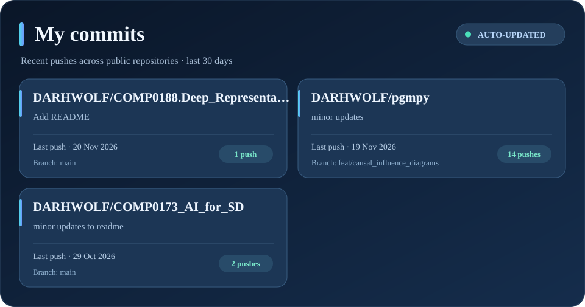

<!--

Here are some ideas to get you started:

- 🔭 I’m currently working on ...
- 🌱 I’m currently learning ...
- 👯 I’m looking to collaborate on ...
- 🤔 I’m looking for help with ...
- 💬 Ask me about ...
- 📫 How to reach me: ...
- 😄 Pronouns: ...
- ⚡ Fun fact: ...
-->
#### When life gives you confounders, uncover the hidden truths. There is occasions and causes why and wherefore in all things.
## Professional Summary

My name is Raunak, and I am a researcher and open-source contributor with a strong interest in causal inference, probabilistic graphical models, and machine learning.
I have actively worked on developing the Python library `pgmpy` for over a year. My work involves implementing algorithms from the causal inference literature. As part of the European Summer of Code 2025, I worked on building tools for causal effect estimation, such as the DoubleML Regressor in a scikit-learn-compatible design. I have implemented several other algorithms, including the self-compatibility metric, Naive IV regressor, and IV identification methods.
I have also previously mentored contributors in open-source programs, helping them work on algorithms such as causal identification and estimation methods.
Currently, I am building an influence diagram class to represent causal decision-making problems.

For my bachelor's thesis, I developed `FermiGates`, a novel algorithm for sparsifying neural networks that yields better predictions without any kind of regularisation.

I am now pursuing my Master's degree in Artificial Intelligence at University College London.

<!-- MY_COMMITS:START -->
## My commits

**Recent repositories:** [DARHWOLF/COMP0188.Deep_Representations_and_Learning](https://github.com/DARHWOLF/COMP0188.Deep_Representations_and_Learning) · [DARHWOLF/pgmpy](https://github.com/DARHWOLF/pgmpy) · [DARHWOLF/COMP0173_AI_for_SD](https://github.com/DARHWOLF/COMP0173_AI_for_SD)

Public push activity from the past 30 days; refreshed automatically every six hours. Private work and unpushed local commits aren't included.
<!-- MY_COMMITS:END -->

<!-- OPEN_PRS:START -->
## My Open Pull Requests

- [Adds causal influence diagram class](https://github.com/pgmpy/pgmpy/pull/3653) - pgmpy - Updated: 2026-11-19
- [Self Compatibility score for the validation of causal discovery algorithms](https://github.com/pgmpy/pgmpy/pull/2058) - pgmpy - Updated: 2026-11-18
- [ports IV identification method](https://github.com/pgmpy/pgmpy/pull/2433) - pgmpy - Updated: 2026-11-18
- [Adds CID enhancement proposal](https://github.com/pgmpy/enhancement_proposals/pull/20) - enhancement_proposals - Updated: 2026-10-16
- [[ENH] add _evalute and _evaluate_by_index methods for MSSE](https://github.com/sktime/sktime/pull/8656) - sktime - Updated: 2025-08-25
- [Add PINO layers and layer tests](https://github.com/deepchem/deepchem/pull/4435) - deepchem - Updated: 2025-05-07
- [Add Physics-Informed Neural Operator (PINO) model and unit tests](https://github.com/deepchem/deepchem/pull/4415) - deepchem - Updated: 2025-05-03
- [Add PINO model and unit tests](https://github.com/deepchem/deepchem/pull/4436) - deepchem - Updated: 2025-05-02
- [[DARHWOLF]: Add me as contributor](https://github.com/vishalj0501/hacktoberfest-2022/pull/31) - hacktoberfest-2022 - Updated: 2022-10-23

*Last updated: 2026-11-25 07:20:03 UTC*
<!-- OPEN_PRS:END -->
<!-- MERGED_PRS:START -->
- [[ENH] ADD DoubleMLRegressor](https://github.com/pgmpy/pgmpy/pull/2288)  - pgmpy
- [[ENH] ADD NaiveIVRegressor](https://github.com/pgmpy/pgmpy/pull/2378)  - pgmpy
- [[ENH] Adds Base Causal Prediction Class ](https://github.com/pgmpy/pgmpy/pull/2418) - pgmpy
 <!-- MERGED_PRS:END -->
 --
 
 

##### Proudly, an Open Sourcerer forged at AmritaVV -- Amritapuri

---
